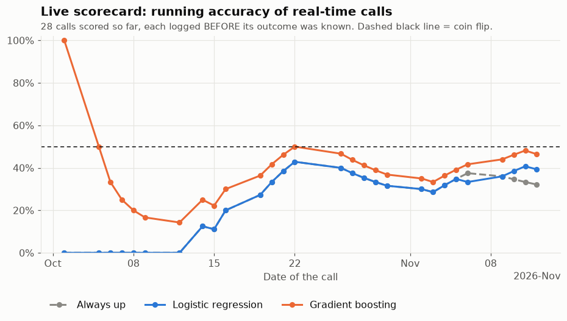

# TSM 5-day call: live scorecard

**Latest call** (close of 2026-11-20, TSM $318.71, result due about 2026-11-27):

- Logistic regression: **UP** (69% chance of UP)
- Gradient boosting: **UP** (93% chance of UP)

## Accuracy so far

| Strategy | Hits / scored | Accuracy | 95% range |
|---|---|---|---|
| Always up | 9 / 29 | 31% | 8% to 69% |
| Logistic regression | 11 / 29 | 38% | 12% to 74% |
| Gradient boosting | 13 / 29 | 45% | 15% to 78% |

The 95% range shows how much of the accuracy could be luck. Daily calls overlap (each covers 5 trading days), so the range treats N calls as about N/5 separate weeks.

## Last 10 calls

| Close of | Logistic | Boosting | Actual 5-day move |
|---|---|---|---|
| 2026-11-20 | UP (69%) | UP (93%) | pending |
| 2026-11-19 | UP (61%) | UP (73%) | pending |
| 2026-11-18 | UP (53%) | UP (71%) | pending |
| 2026-11-17 | UP (59%) | UP (74%) | pending |
| 2026-11-16 | UP (61%) | UP (61%) | pending |
| 2026-11-13 | UP (54%) | UP (61%) | DOWN (-20.1%) |
| 2026-11-12 | UP (52%) | UP (59%) | DOWN (-13.2%) |
| 2026-11-11 | DOWN (45%) | DOWN (42%) | DOWN (-12.3%) |
| 2026-11-10 | DOWN (45%) | DOWN (44%) | DOWN (-9.3%) |
| 2026-11-09 | DOWN (44%) | DOWN (41%) | DOWN (-3.9%) |

