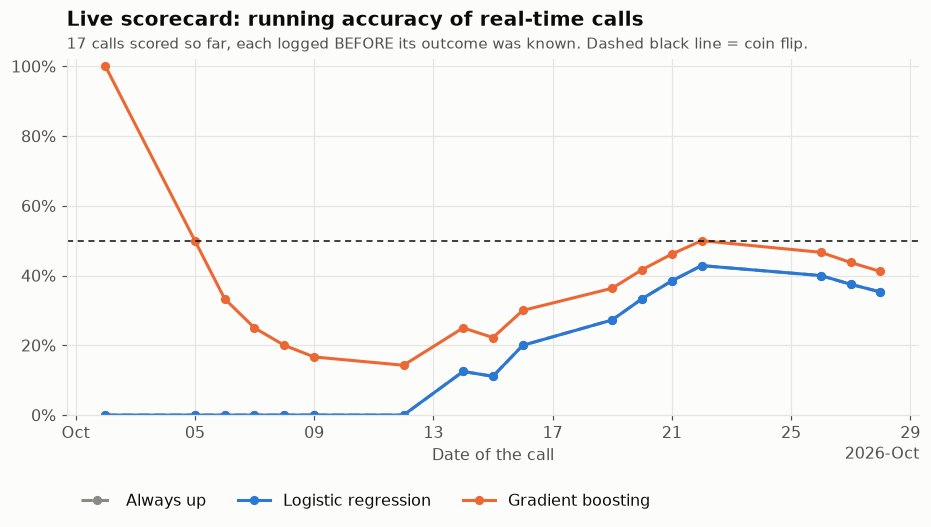

# TSM 5-day call: live scorecard

**Latest call** (close of 2026-11-03, TSM $404.80, result due about 2026-11-10):

- Logistic regression: **UP** (55% chance of UP)
- Gradient boosting: **UP** (73% chance of UP)

## Accuracy so far

| Strategy | Hits / scored | Accuracy | 95% range |
|---|---|---|---|
| Always up | 6 / 16 | 38% | 8% to 81% |
| Logistic regression | 6 / 16 | 38% | 8% to 81% |
| Gradient boosting | 7 / 16 | 44% | 10% to 84% |

The 95% range shows how much of the accuracy could be luck. Daily calls overlap (each covers 5 trading days), so the range treats N calls as about N/5 separate weeks.

## Last 10 calls

| Close of | Logistic | Boosting | Actual 5-day move |
|---|---|---|---|
| 2026-11-03 | UP (55%) | UP (73%) | pending |
| 2026-11-02 | UP (57%) | UP (80%) | pending |
| 2026-10-30 | UP (63%) | UP (67%) | pending |
| 2026-10-29 | UP (61%) | UP (57%) | pending |
| 2026-10-28 | UP (58%) | UP (64%) | pending |
| 2026-10-27 | UP (54%) | UP (54%) | DOWN (-7.3%) |
| 2026-10-26 | UP (54%) | UP (54%) | DOWN (-6.1%) |
| 2026-10-22 | UP (60%) | UP (62%) | UP (+4.7%) |
| 2026-10-21 | UP (54%) | UP (60%) | UP (+1.8%) |
| 2026-10-20 | UP (54%) | UP (66%) | UP (+2.8%) |

