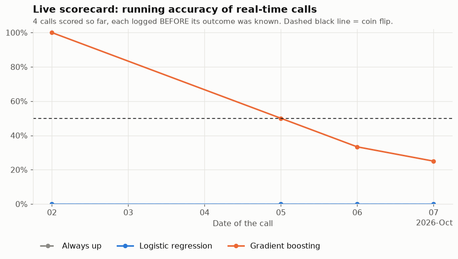

# TSM 5-day call: live scorecard

**Latest call** (close of 2026-10-28, TSM $439.51, result due about 2026-11-04):

- Logistic regression: **UP** (58% chance of UP)
- Gradient boosting: **UP** (64% chance of UP)

## Accuracy so far

| Strategy | Hits / scored | Accuracy | 95% range |
|---|---|---|---|
| Always up | 5 / 13 | 38% | 7% to 84% |
| Logistic regression | 5 / 13 | 38% | 7% to 84% |
| Gradient boosting | 6 / 13 | 46% | 10% to 87% |

The 95% range shows how much of the accuracy could be luck. Daily calls overlap (each covers 5 trading days), so the range treats N calls as about N/5 separate weeks.

## Last 10 calls

| Close of | Logistic | Boosting | Actual 5-day move |
|---|---|---|---|
| 2026-10-28 | UP (58%) | UP (64%) | pending |
| 2026-10-27 | UP (54%) | UP (54%) | pending |
| 2026-10-26 | UP (54%) | UP (54%) | pending |
| 2026-10-22 | UP (60%) | UP (62%) | pending |
| 2026-10-21 | UP (54%) | UP (60%) | UP (+1.8%) |
| 2026-10-20 | UP (54%) | UP (66%) | UP (+2.8%) |
| 2026-10-19 | UP (54%) | UP (59%) | UP (+1.0%) |
| 2026-10-16 | UP (60%) | UP (74%) | UP (+1.4%) |
| 2026-10-15 | UP (56%) | UP (73%) | DOWN (-2.3%) |
| 2026-10-14 | UP (60%) | UP (60%) | UP (+0.4%) |

